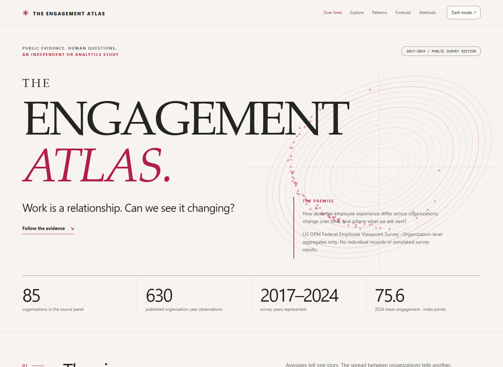

# The Engagement Atlas

### Work is a relationship. Can we see it changing?

An independent, AI-assisted **HR analytics study of real public agency-level
employee survey statistics**. Eight survey years. Multiple perspectives on
employee engagement. A visual story that lets you inspect the evidence.

**[Explore the live atlas](https://mbc81.github.io/engagement-atlas/)** ·
**[Notebook](notebooks/engagement_atlas.ipynb)** ·
**[Methods](METHODOLOGY.md)** · **[Data provenance](DATA_SOURCES.md)**

[](https://mbc81.github.io/engagement-atlas/)

## The questions

**What does engagement look like across organizations?** Follow published
engagement, leadership, supervisory support, intrinsic work experience, and
satisfaction measures across the US federal survey's reporting agencies.
The living trajectory atlas follows the same organizations through time:
one rising average can conceal very different journeys.

**Do levels and changes tell the same story?** Compare cross-sectional
associations with within-organization annual changes, uncertainty, and
multivariate profiles. Examine the distinction between stated intention to
leave and actual employee turnover.

**Does advanced ML earn its complexity?** Forecast next-year engagement with
ridge, elastic net, random forests, extra trees, and gradient boosting.
Compare them with a simple prior-year persistence forecast. Select on
earlier rolling validation years, reserve a calibration year, and evaluate
on a genuinely later test year. If the simple model wins, say so.
A separate nested rolling-origin audit repeats earlier-only selection and
calibration across several target years. A matched prior-score-only Ridge
ablation asks whether the additional indexes earn their place.

## What is inside

| Experience | Evidence |
|---|---|
| Interactive editorial story | Living agency trajectories, levels/change reveal, searchable organization explorer, continuous profiles, paired agency-error swarm, model tournament |
| In-depth executed notebook | Data quality, distributions, outliers, relationship tests, temporal comparisons, clustering, predictive evaluation, HR interpretation |
| Statistical analysis | Spearman correlations, false-discovery adjustment, agency-trajectory bootstrap, first-difference regression with clustered uncertainty |
| Advanced machine learning | Five regularized/ensemble models, expanding-window validation, persistence baseline, permutation importance, calibration intervals |
| Interpretation checks | Nested rolling-origin audit, matched feature ablation, paired model-error differences, continuous-cohort change, one-score cluster comparison, intention coverage and leave-one-agency-out sensitivity |
| Reproducible publication | Source checksums, processed public aggregates, machine-readable results, tests, locked dependencies, GitHub Actions |

**Real data, not synthetic.** These are published **organization aggregates**
from the [OPM Federal Employee Viewpoint Survey](https://www.opm.gov/fevs/reports/data-reports/),
covering **2017–2024**. There are no employee-level records, names, identifiers,
or Microsoft/customer data. The survey respondents are real people; the
analysis units are public reporting organizations.

## Read the results

[Executive findings](outputs/FINDINGS.md) ·
[Analysis JSON](outputs/atlas.json) ·
[Public aggregate panel](data/processed/agency_panel.csv) ·
[Forecast observations](outputs/forecast_panel.csv) ·
[All-model held-out predictions](outputs/model_predictions.csv) ·
[Rolling-origin predictions](outputs/rolling_predictions.csv) ·
[Figures](outputs/figures)

The website is **static and self-contained**: no installation, account,
telemetry, employee scoring, or external chart service is needed.

## Reproduce

Python 3.11 is the tested runtime. On Windows:

```powershell
python -m venv .venv
.\.venv\Scripts\python.exe -m pip install -r requirements-lock.txt
.\.venv\Scripts\python.exe -m atlas.build --offline
.\.venv\Scripts\python.exe scripts\create_notebook.py --execute
.\.venv\Scripts\python.exe -m pytest
.\.venv\Scripts\python.exe -m ruff check atlas tests scripts
.\.venv\Scripts\python.exe scripts\check_site.py
.\.venv\Scripts\python.exe -m playwright install chromium
.\.venv\Scripts\python.exe scripts\check_browser.py
```

To download the original public XLSX files again and rebuild the panel:

```powershell
.\.venv\Scripts\python.exe -m atlas.build --refresh
```

The offline path rebuilds the analysis from the committed processed
public-aggregate panel. Refresh downloads directly from OPM and records the
file URLs and SHA-256 checksums in `outputs/source_manifest.json`.
Original downloaded workbooks remain in ignored `data/raw/`.

The publication helper uses the signed-in `Mbc81` account and publishes the
prepared profile link only after the live site is verified:

```powershell
.\.venv\Scripts\python.exe scripts\publish.py
```

The source spans successive rolling reports. In overlapping years, the newer
edition takes precedence. Organization names match exactly; unmatched renames
are not guessed or silently merged. Governmentwide and size-tier totals are
excluded, along with the Defense parent rollup to avoid overlap with retained
Defense components.

## Responsible interpretation

These are **survey associations and retrospective forecasts**, not causes,
individual employee predictions, or evidence of an effective HR intervention.
Some measures share questionnaire items; their concurrent correlations can be
partly mechanical. Survey nonresponse, rounded published estimates, organization
changes, and a relatively small organization sample limit interpretation.

Organization means are **not** official governmentwide respondent-weighted
estimates. Agency size is descriptive context, not demographic fairness evidence.
Self-reported intention to leave is **not** actual attrition. Bootstrap intervals
describe between-organization uncertainty; they do not recover survey sampling
errors. Time-shifted prediction intervals are evaluated rather than assumed valid.

The component regression is a **measurement demonstration**, not discovery of
engagement drivers. Profiles are presented continuously; discrete clusters add
little when the same partition can be reproduced by one overall score.
Rolling-origin results are retrospective sensitivity checks, not fresh
independent holdouts or forecasts reconstructed from historical publication
vintages. No independently measured turnover outcome has been validated here.

This is an independent learning and portfolio project, **not an OPM or Microsoft
product, endorsement, or claim of professional business impact**.

## Credits and reuse

Original code and design: [mberca](https://github.com/mberca), MIT license.
Source statistics: US Office of Personnel Management, Federal Employee Viewpoint
Survey; federal government works, [17 USC §105](https://www.law.cornell.edu/uscode/text/17/105).
See [DATA_SOURCES.md](DATA_SOURCES.md) for exact sources and exclusions.
